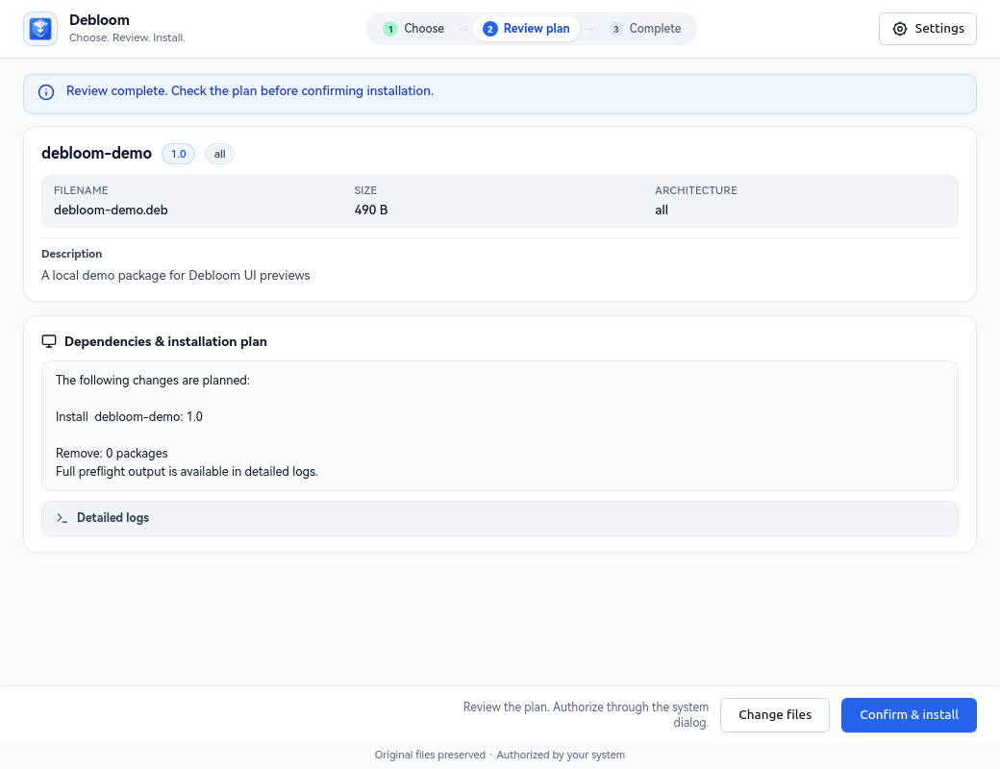
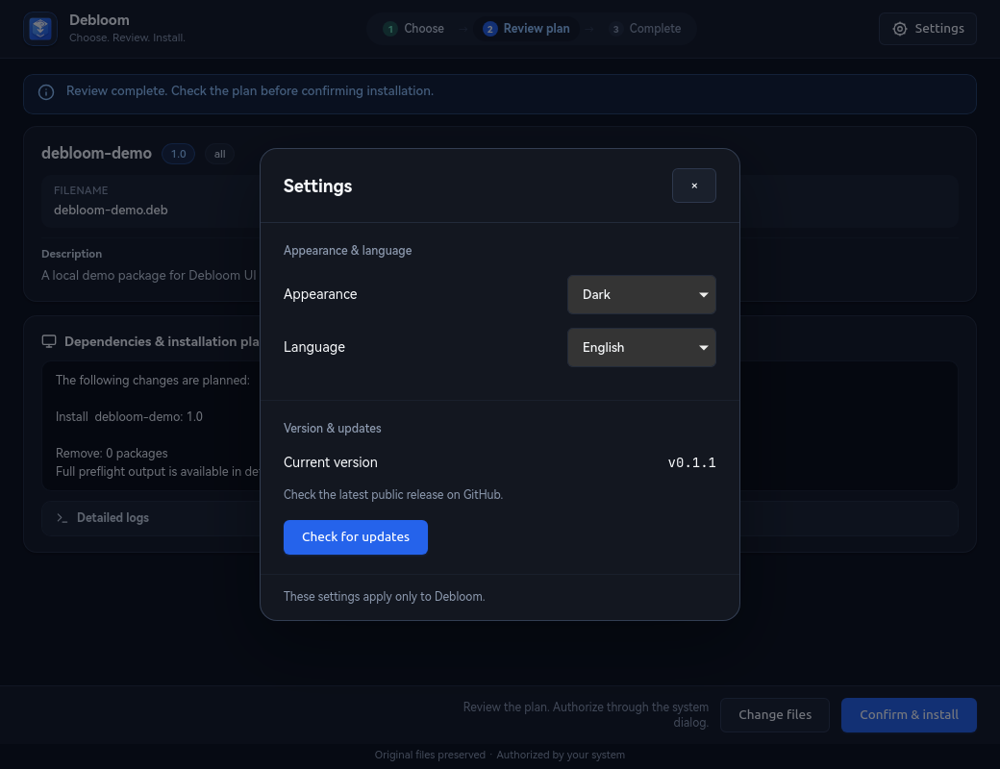

# Debloom


[简体中文](README.md) · [Releases](https://github.com/TengJoe/debloom/releases) · [Verification](docs/VERIFICATION.md)

**Review first. Install with confidence.** Debloom is a native desktop installer for local Ubuntu and Debian DEB packages. Choose files, inspect their metadata, review the APT plan, then authorize through your system.

Built with an offline HTML/CSS/JavaScript interface, WebKitGTK, GTK and a Python backend. No web server or browser service is required.

## Preview

| Light | Dark |
|---|---|
|  |  |


These are real WebKitGTK screenshots using an inert demo DEB and APT simulation. No demo package was installed.

## Features

- Multiple local DEBs, file-manager opening and native file drops.
- Package versions, architecture, size, description and installed version.
- APT preflight with a readable install, upgrade and configuration plan; removal plans are rejected.
- System authorization, live logs and independent package-state readback after installation.
- Light, dark and system appearance; Chinese and English; persistent preferences.
- Built-in settings and an explicit GitHub Release update check.
- Original files preserved; staging permissions let `_apt` read the temporary copy.
- Per-user deployment with backups and rollback that refuses later edits.

## Settings and updates

The **Settings** button contains appearance, language, current version and **Check for updates**. Preferences affect only Debloom. Package metadata and original APT logs remain verbatim.



The update checker reads the public `TengJoe/debloom` latest Release API only when requested. It displays a newer version and offers **Open release page**. It does not install updates or execute downloaded programs.

## Install

Requires a Linux desktop, Python 3.11+, GTK 4.10+, libadwaita, the WebKitGTK 6.0 API, librsvg, APT, dpkg and pkexec. Ubuntu 24.04+ provides the required desktop packages. The actual tested environment and limitations are recorded in [Verification](docs/VERIFICATION.md).

Install missing dependencies from your terminal:

```bash
sudo apt install python3-gi python3-cairo python3-gi-cairo \
  gir1.2-gtk-4.0 gir1.2-adw-1 gir1.2-webkit-6.0 gir1.2-rsvg-2.0 pkexec
```

Install the application as your ordinary user, without sudo:

```bash
git clone https://github.com/TengJoe/debloom.git
cd debloom
/usr/bin/python3 install.py
/usr/bin/python3 install.py --apply
~/.local/bin/debloom
```

Search for **Debloom** in your application menu. Run `debloom` directly if `~/.local/bin` is on PATH. The installer registers user-local application files, a desktop entry and nine icon sizes; it does not change the desktop theme or default DEB handler. `deb-install-gui` remains compatible.

## Workflow

1. Choose or drop local DEBs.
2. Review package metadata and click **Review plan**.
3. Check the changes and click **Confirm & install**.
4. Authenticate in the system dialog.
5. Inspect the result and logs. Already-installed versions with no pending changes cannot be installed again.

Debloom has no password field. The GUI checks file hashes, package state and the plan before authorization, rechecks after authorization, and validates the final APT transaction before dpkg runs. It preserves existing configuration files and does not enable downgrade, hold-change or authentication-bypass flags.

Use trusted DEBs: package maintenance scripts can run as root. Debloom does not verify third-party publisher signatures, and a failed installation does not imply automatic rollback of system packages.

## Update and rollback

```bash
git pull --ff-only
/usr/bin/python3 install.py --apply
```

Installation prints a guarded backup receipt. Use its actual path:

```bash
/usr/bin/python3 install.py --rollback /actual/receipt.json
/usr/bin/python3 install.py --rollback /actual/receipt.json --apply
```

Rollback checks every target and backup first, refuses later edits, and archives added files. It restores the Debloom application, not system packages installed through it. For multiple deployments, roll back from newest to oldest.

[Performance measurements and limits](bench/REPORT.md) · See [0.1.1 changes](CHANGELOG.md) for the XDG and desktop path fixes.

## Development

```bash
/usr/bin/python3 -m unittest discover -v
/usr/bin/python3 scripts/sync_ui_assets.py
/usr/bin/python3 scripts/capture_previews.py
/usr/bin/python3 scripts/render_cover.py
```

Preview capture requires a graphical session and disables real installation. Tests use isolated APT state and a dpkg stub. Real root authorization, actual system writes and a complete screen-reader workflow still require separate acceptance.

The preserved `deb-install` terminal helper uses native sudo/APT confirmation. The extra transaction guards documented above belong to the graphical Debloom path.
