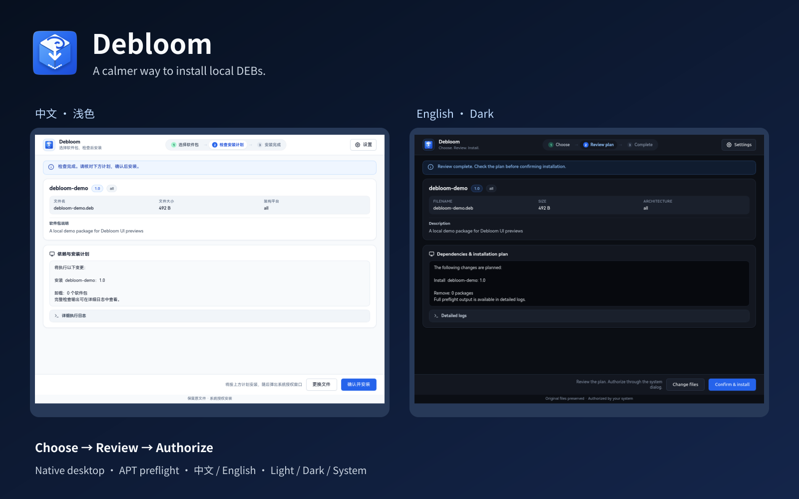
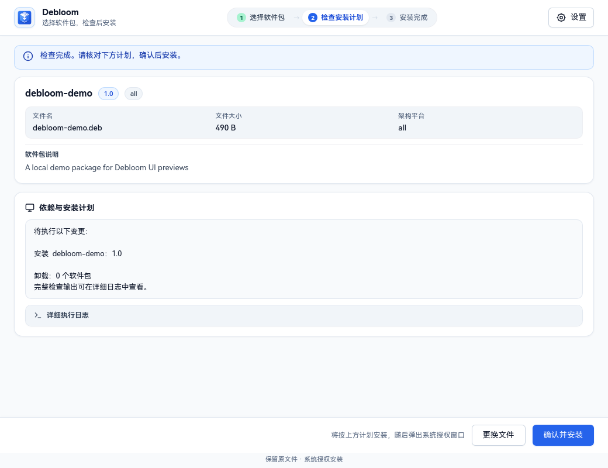
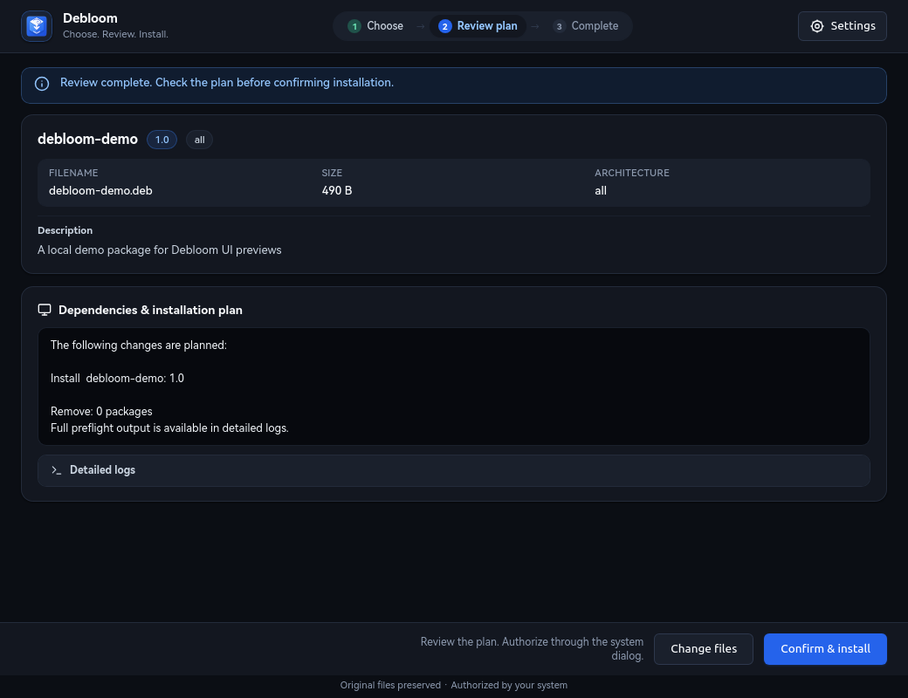
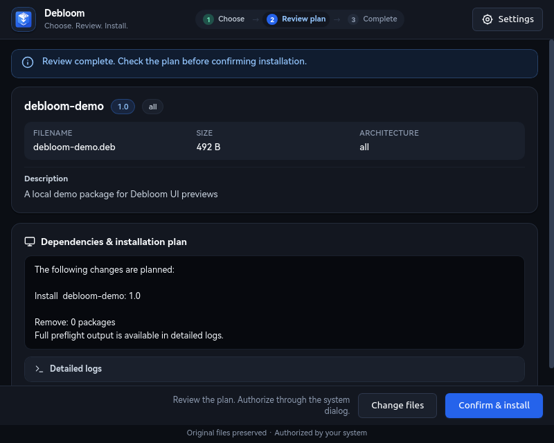
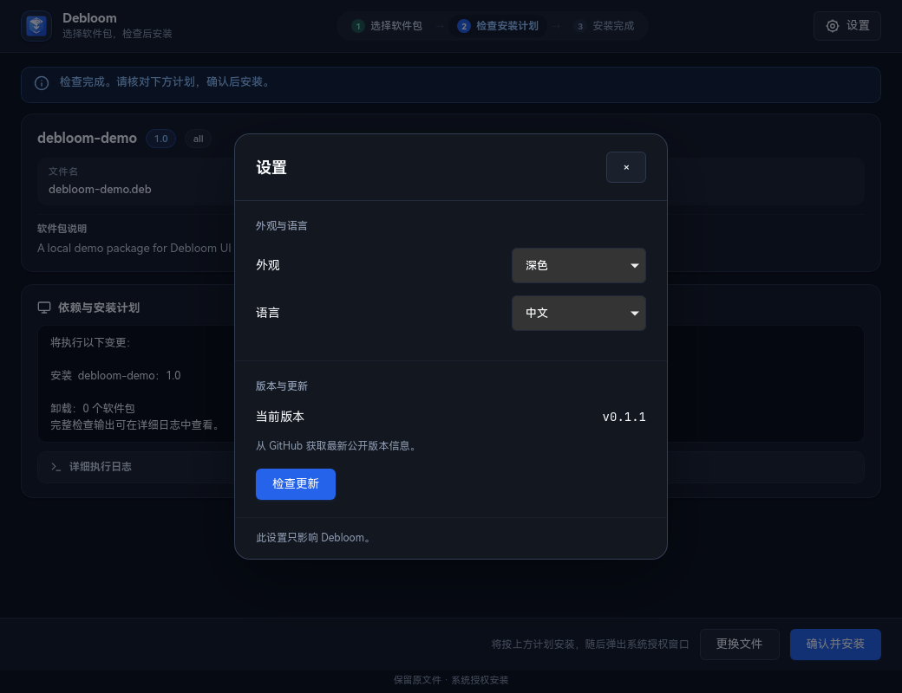

# Debloom



[English](README.en.md) · [发布版本](https://github.com/TengJoe/debloom/releases) · [验证记录](docs/VERIFICATION.md)

**先看清，再安装。** Debloom 是 Ubuntu / Debian 的本地 DEB 图形安装器。选择文件、查看软件包信息、检查 APT 计划，再通过系统授权完成安装。

采用 HTML / CSS / JavaScript、WebKitGTK 原生窗口和 Python 后端，无常驻网页服务。软件名称统一为 **Debloom**，界面支持中文与 English。

## 界面预览

| 中文 · 浅色 | English · 深色 |
|---|---|
|  |  |



截图来自真实 WebKitGTK 窗口，使用无安装脚本的演示 DEB 执行 APT 模拟，未实际安装演示软件。制作方式见 [图片渲染脚本](scripts/capture_previews.py)。

## 功能

- 多选本地 `.deb` 文件，支持文件管理器打开和拖入窗口。
- 显示包名、版本、架构、大小、描述和已安装版本。
- 安装前展示 APT 的安装 / 升级 / 配置计划；需要移除现有软件的计划会被拒绝。
- 等待系统授权和执行安装分别显示，安装后读取实际版本与配置状态确认结果。
- 详细日志可展开，长包名和长路径自动换行，底部操作在小窗口保持可见。
- 内置设置：浅色 / 深色 / 跟随系统，中文 / English，保存每个用户的选择。
- 手动检查 GitHub 最新公开 Release，有新版时提供发布页入口。
- 保留原 DEB，准备 `_apt` 可读取的临时副本，避免因家目录权限产生脱离沙盒的提示。
- 当前用户安装、备份和带哈希保护的回退；发现后续编辑时拒绝覆盖。

## 设置与更新

点击右上角 **设置**，统一调整外观和语言，并查看当前版本。设置只作用于 Debloom，不修改 GNOME 全局主题。



**检查更新** 会请求公开的 `TengJoe/debloom` GitHub Release API。没有后台轮询，不需要 GitHub 登录；界面显示当前版本、检查结果和新版版本号。点击 **打开发布页** 后可查看更新说明及源码下载。检查更新不接收包管理器密码，也不执行下载到的程序。

语言与外观偏好存放在 `${XDG_CONFIG_HOME:-~/.config}/local-deb-installer/`，文件权限为 `600`。包名、原始描述和 APT 原始日志保留原文，不自动翻译第三方软件内容。

## 安装

需要 Linux 桌面、Python 3.11+、GTK 4.10+、libadwaita、WebKitGTK 6.0 API、librsvg 和系统 APT / dpkg / pkexec。Ubuntu 24.04+ 提供所需桌面组件；实际验证环境与版本见 [验证范围](docs/VERIFICATION.md)。

如系统缺少依赖，可在自己的终端安装：

```bash
sudo apt install python3-gi python3-cairo python3-gi-cairo \
  gir1.2-gtk-4.0 gir1.2-adw-1 gir1.2-webkit-6.0 gir1.2-rsvg-2.0 pkexec
```

Debloom 本身使用普通用户安装：

```bash
git clone https://github.com/TengJoe/debloom.git
cd debloom
/usr/bin/python3 install.py          # 检查依赖和部署文件，不写入
/usr/bin/python3 install.py --apply  # 当前用户安装，并保存备份收据
~/.local/bin/debloom
```

随后可在应用菜单搜索 **Debloom**。如果 `~/.local/bin` 已在 PATH 中，直接执行 `debloom` 即可。

应用文件安装到 `~/.local/lib/local-deb-installer/`，入口注册到用户应用目录，图标生成 16–512px 九种尺寸。现有 `DockNormalized` 用户图标主题也会同步本应用图标，不改变其他图标或主题设置。内部路径与旧命令 `deb-install-gui` 保留兼容。

可直接传入多个文件：

```bash
debloom "$HOME/Downloads/app.deb" "$HOME/Downloads/dependency.deb"
```

Debloom 不改变 `.deb` 的默认打开程序；可以从文件管理器的“打开方式”选择它。

## 使用流程

1. 选择或拖入本地 DEB。
2. 查看信息，点击 **检查安装计划**。
3. 核对变更，点击 **确认并安装**。
4. 在系统授权窗口验证身份。
5. 查看结果和日志。相同版本已安装且无计划变更时，安装按钮会禁用。

密码由系统 `pkexec` 处理，Debloom 没有密码输入框。安装前复查包哈希、系统状态和计划；授权后再次检查，并在 APT 调用 dpkg 前核对实际事务。保留现有配置文件，不启用允许降级、改变 hold 或绕过源认证的选项。

DEB 的维护脚本可以以 root 执行，请选择可信来源。Debloom 不验证第三方发布者签名；安装失败不表示系统软件已经自动回滚。强制终止进程或断电也不能保证临时副本清理。

## 更新与回退 Debloom

在源码目录拉取更新，再执行同一安装命令：

```bash
git pull --ff-only
/usr/bin/python3 install.py --apply
```

安装完成会打印本次备份的 `receipt.json` 路径。将打印出的真实路径用于只读检查或执行回退：

```bash
/usr/bin/python3 install.py --rollback /实际收据路径/receipt.json
/usr/bin/python3 install.py --rollback /实际收据路径/receipt.json --apply
```

先校验所有当前文件和备份哈希；后续编辑会阻止回退。新增加的应用文件移到收据旁的归档目录，避免永久删除。该回退恢复的是 Debloom 应用文件和入口，不回退用户通过它安装的系统软件。多次安装对应独立收据，按最新到最旧顺序恢复。

[性能测量与方法限制](bench/REPORT.md) · 修复空／相对 XDG 路径及特殊字符桌面入口，详见 [0.1.1 变更](CHANGELOG.md)。

## 开发与验证

```bash
/usr/bin/python3 -m unittest discover -v
/usr/bin/python3 scripts/sync_ui_assets.py
/usr/bin/python3 scripts/capture_previews.py
/usr/bin/python3 scripts/render_cover.py
```

截图脚本需要图形会话，只使用演示包和 APT 模拟；原生 smoke 模式禁用真实安装。测试使用隔离 APT 状态和 dpkg 替身，不向真实系统安装测试包。

完整测试覆盖外观、语言、更新、图形控制、包处理、APT Hook、终端兼容入口、部署与回退。实际 root 授权、真实系统写入和全套屏幕阅读器操作仍需单独验收，不能用模拟结果代替。

保留的 `deb-install` 是交互式终端兼容工具，使用 sudo / APT 原生确认；上述图形界面额外事务守卫属于 Debloom GUI 路径。

## 设计参考

布局和交互参考 [Emil Kowalski](https://emilkowal.ski/ui/7-practical-animation-tips)、[Rauno Freiberg](https://rauno.me/craft/depth) 与 [Paco Coursey](https://paco.me/craft) 的界面实践。Logo 为本项目自包含 SVG：立体软件包仓、旋涡弧线、白色安装箭头和连续曲率角底板。
